

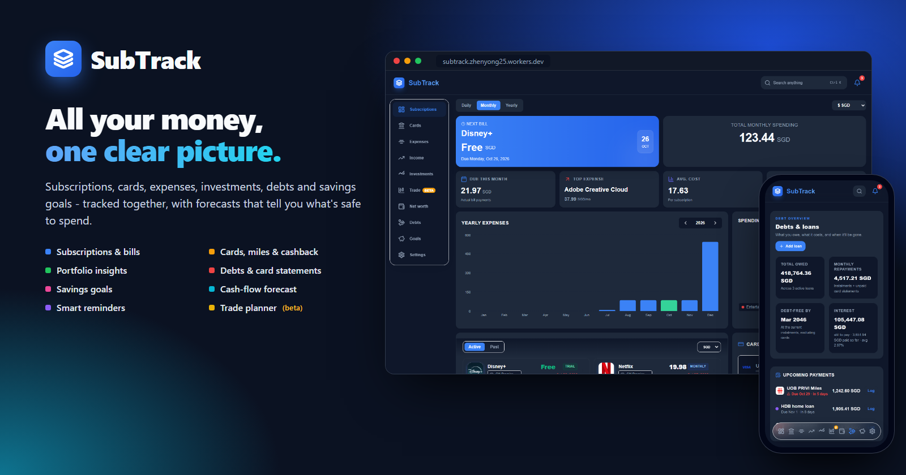

# SubTrack

**All your money, one clear picture.** Subscriptions, cards, expenses, income, investments, debts and savings goals - tracked together, with forecasts that tell you what's safe to spend.

[Open the app](https://subtrack.zhenyong25.workers.dev) · [Watch the 45-second promo video](docs/media/subtrack-promo.webm) · [Run it locally](#run-locally)

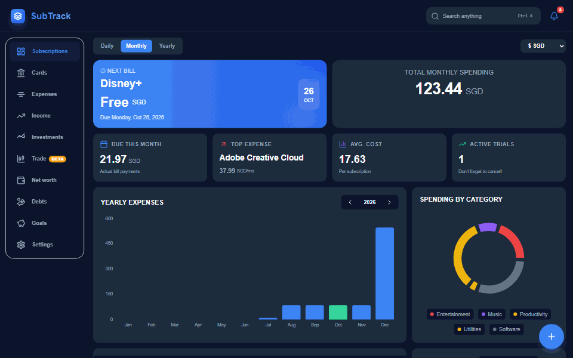

## See it in action

<table>
  <tr>
    <td width="50%">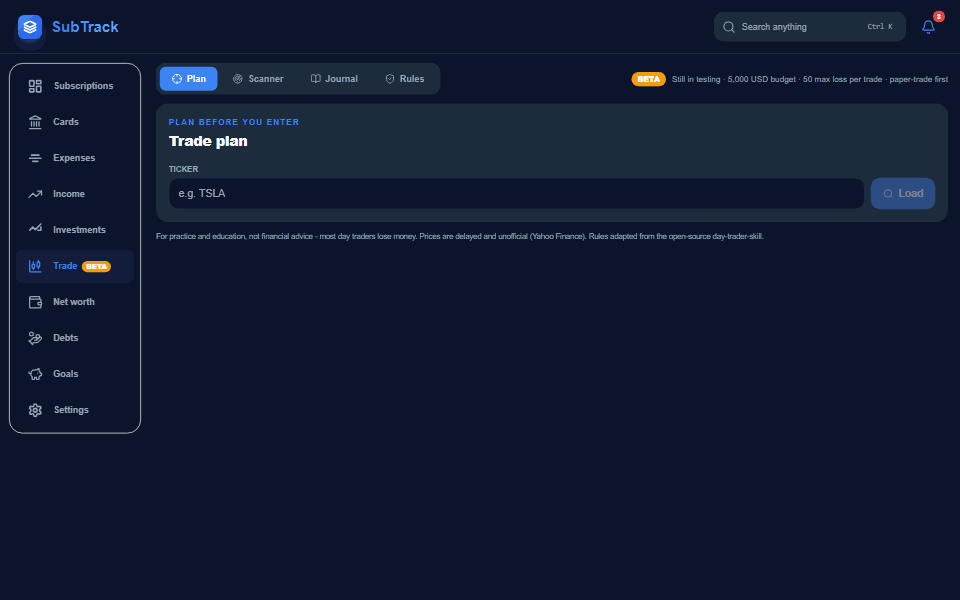</td>
    <td width="50%"></td>
  </tr>
  <tr>
    <td><b>Trade planner (beta)</b> - size a trade from your stop, check it against your risk rules, and replay the rest of the day 10,000 times before you enter.</td>
    <td><b>Search everything</b> - Ctrl/Cmd+K finds expenses, subscriptions and trades as you type, with <code>#tags</code>.</td>
  </tr>
</table>

## Features

<table>
  <tr>
    <td width="50%">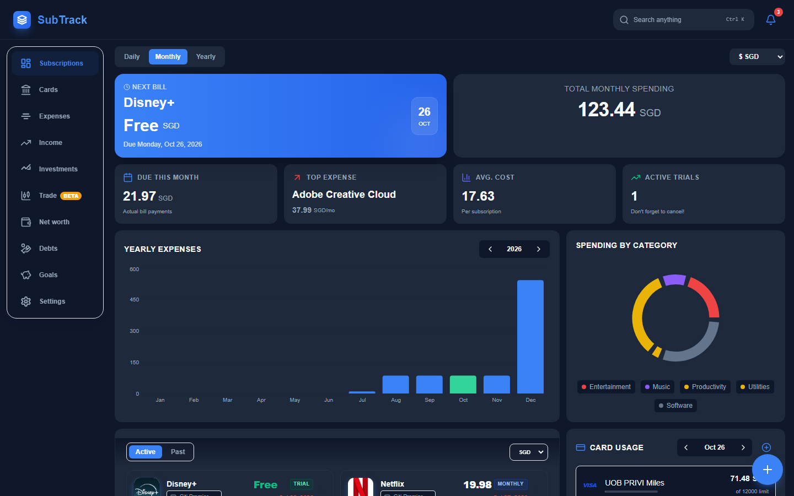 <b>Subscriptions &amp; bills</b> Renewals, free trials and shared plans with logos, card usage and yearly spend.</td>
    <td width="50%">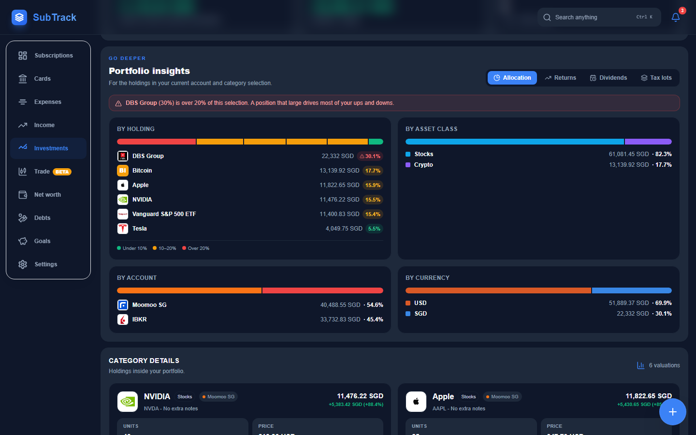 <b>Portfolio insights</b> Allocation by holding, asset class, account and currency, with concentration alerts.</td>
  </tr>
  <tr>
    <td>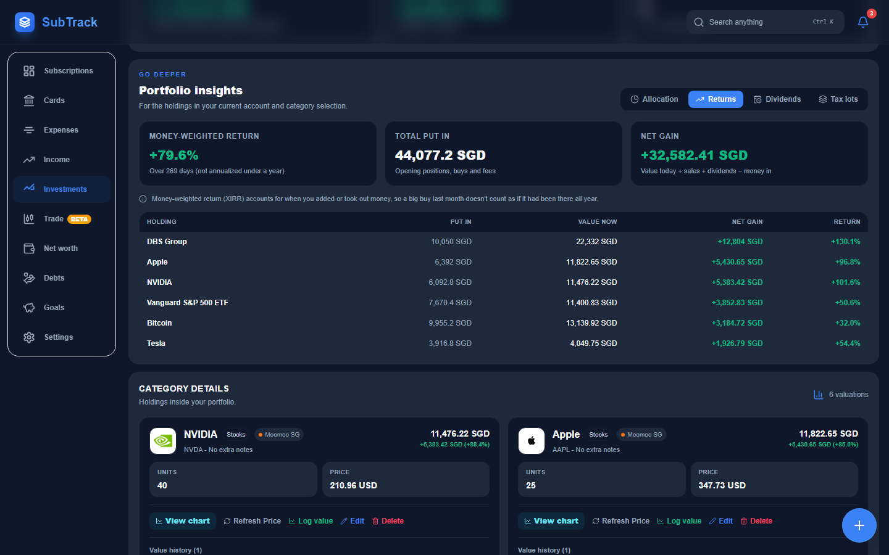 <b>Real returns</b> Money-weighted returns (XIRR), dividends with upcoming payments, and FIFO tax lots.</td>
    <td>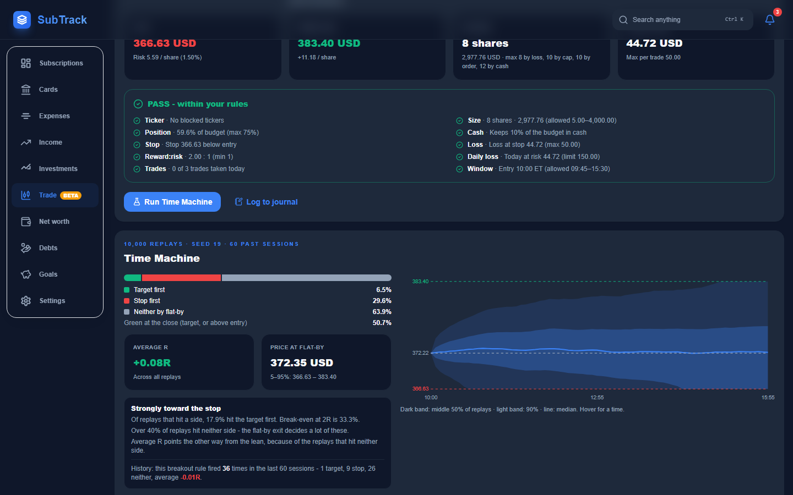 <b>Time Machine</b> Odds of hitting target or stop first, built from the stock's own last 60 days.</td>
  </tr>
  <tr>
    <td>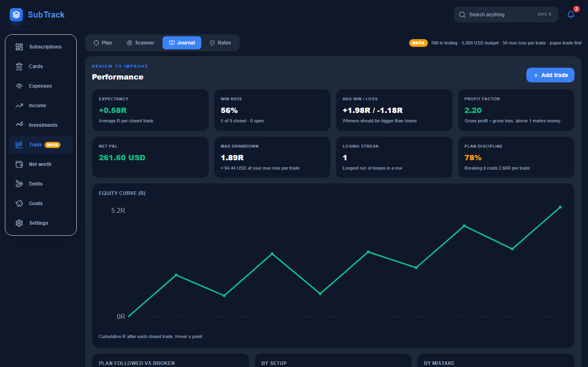 <b>Trade journal</b> Expectancy, profit factor, equity curve in R - and what breaking your plan costs.</td>
    <td>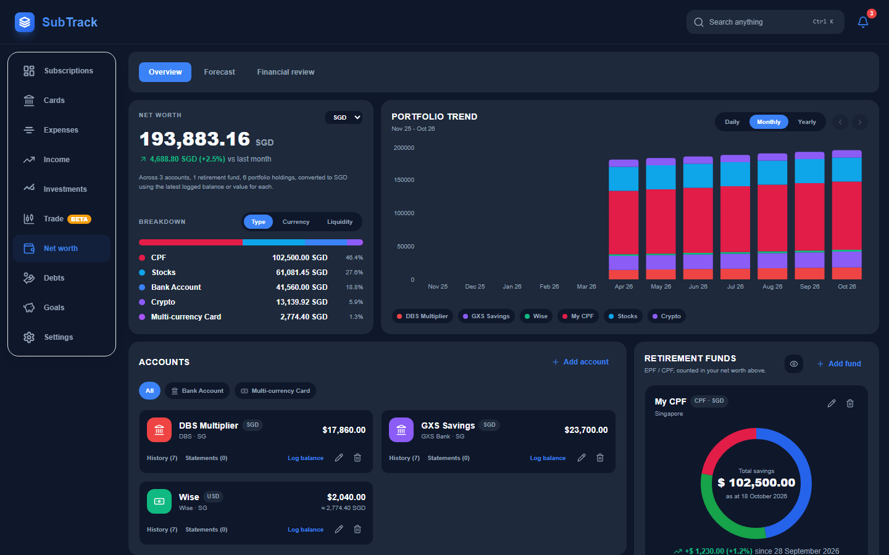 <b>Net worth</b> Bank accounts, investments and CPF in one number, month by month.</td>
  </tr>
  <tr>
    <td>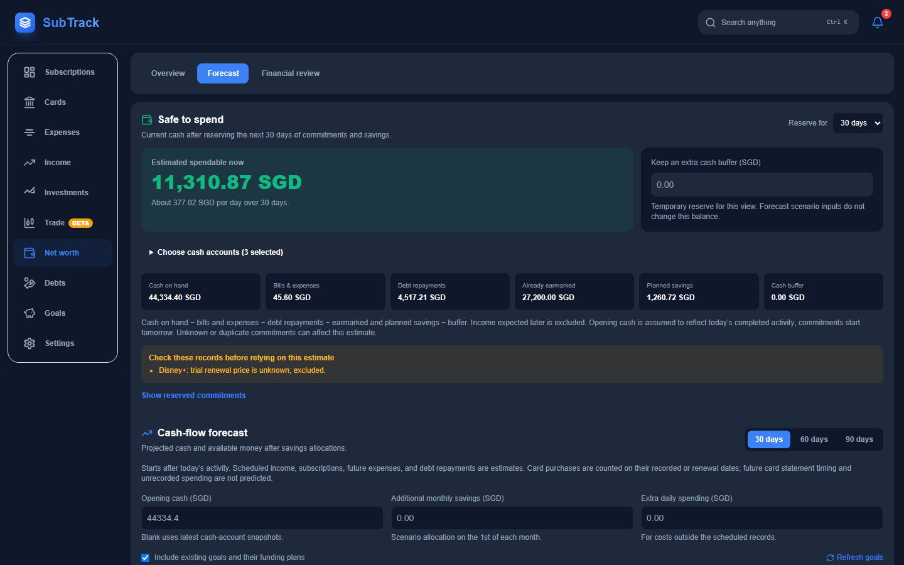 <b>Safe to spend &amp; forecast</b> What's left after bills, debts and savings, 30, 60 or 90 days ahead.</td>
    <td>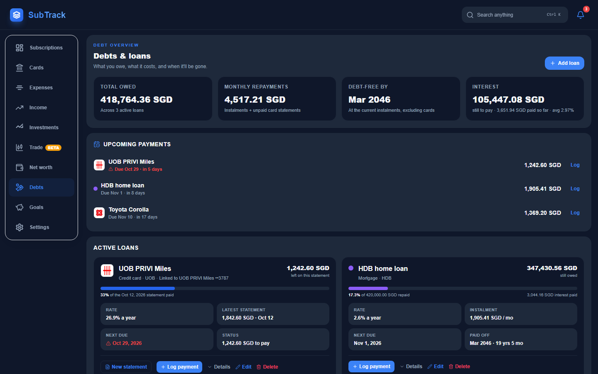 <b>Debts &amp; loans</b> Card statements, mortgages and car loans with due dates, payoff dates and real rates.</td>
  </tr>
  <tr>
    <td>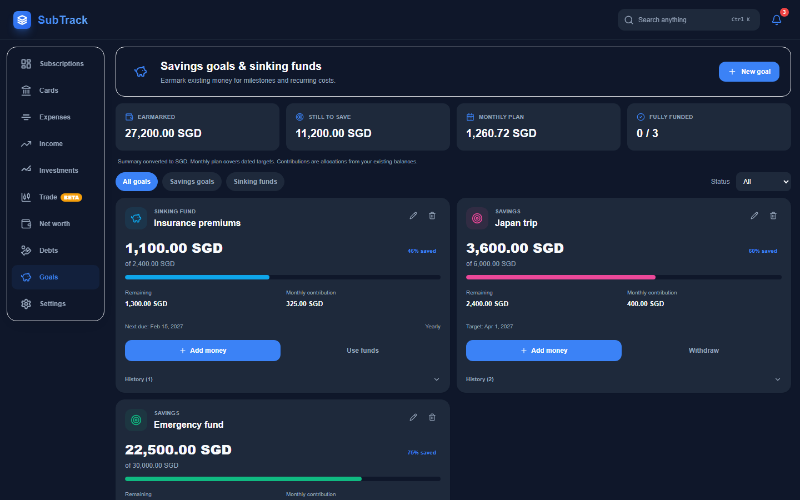 <b>Savings goals</b> Targets, monthly funding plans and sinking funds for known costs.</td>
    <td>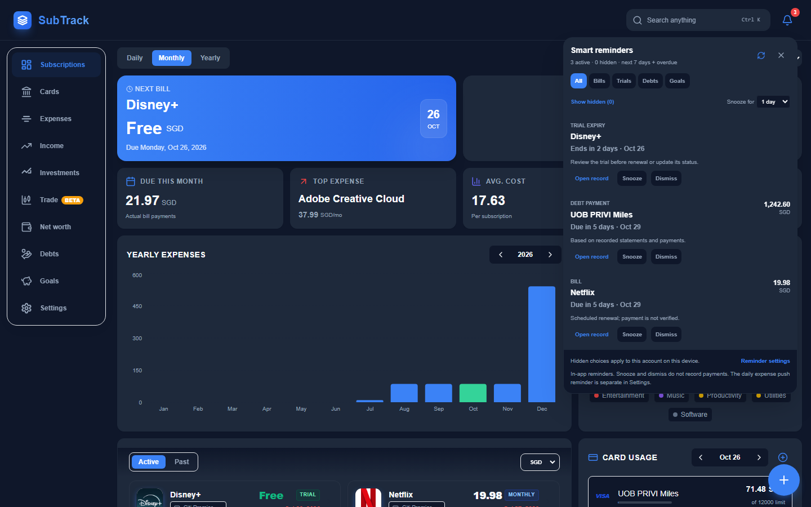 <b>Smart reminders</b> Bills, trial expiries, debt payments and goal deadlines in one list.</td>
  </tr>
</table>

  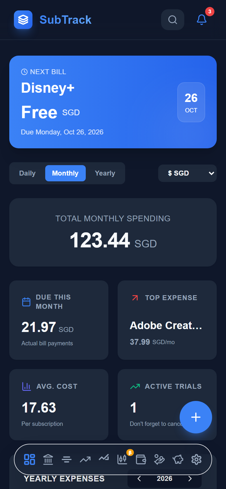
  &nbsp;&nbsp;
  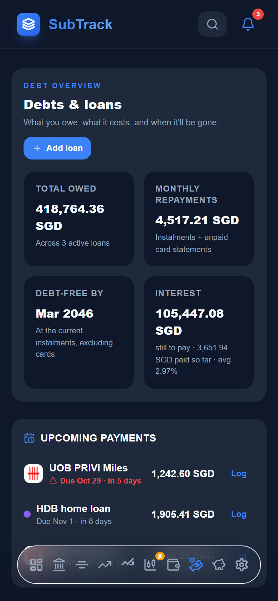
   Installable as an app on your phone, with a full sidebar layout on desktop.

Screenshots use fictional demo data. The Trade tab is in beta and is for practice and education, not financial advice.

## Run Locally

**Prerequisites:**  Node.js

1. Install dependencies:
   `npm install`
2. Set the `GEMINI_API_KEY` in [.env.local](.env.local) to your Gemini API key
3. Run the app:
   `npm run dev`

## Cloudflare Pages

This app is ready to deploy to Cloudflare Pages.

Build settings:

- Build command: `npm run build`
- Output directory: `dist`

If you use the included GitHub Actions workflow, add these repository secrets later:

- `CLOUDFLARE_ACCOUNT_ID`
- `CLOUDFLARE_API_TOKEN`
- `GEMINI_API_KEY`

Add this repository variable too:

- `CLOUDFLARE_PAGES_PROJECT_NAME`

If you prefer Cloudflare Pages Git integration instead of GitHub Actions, connect the GitHub repo in the Cloudflare dashboard, use the same build command and output directory, and add `GEMINI_API_KEY` as a Pages environment variable there.

## Supabase

For searchable subscription names, automatic logos, and the ready-to-run catalog SQL, see [Subscription service catalog setup](docs/subscription-service-catalog.md).

To connect the app to your Supabase database later, add these Vite environment variables:

- `VITE_SUPABASE_URL`
- `VITE_SUPABASE_ANON_KEY` or `VITE_SUPABASE_PUBLISHABLE_KEY`

For sign-up confirmation emails to work on other devices, also set `VITE_APP_URL` to your deployed URL, and in the Supabase dashboard (Authentication > URL Configuration) set **Site URL** to that URL and add it under **Redirect URLs**. Otherwise the confirmation link points at `localhost`, which a phone can't reach.

The app will use Supabase when those values are present and fall back to localStorage if they are missing. Because your tables are tied to `auth.users.id`, real database writes still require a signed-in Supabase user session.

## Global search and tags

Use the header search button or Ctrl+K / Command+K to search expenses, subscriptions, and investment transactions. Select a result to edit its tags; use `#travel` or the tag filters to find related records.

For cloud tag storage, run [supabase_global_search_tags.sql](supabase_global_search_tags.sql) in Supabase and reload the app. Local-only storage works immediately. See [Global search setup and behavior](docs/global-search.md).

Run `npm run test:search` to check search matching and tag persistence.

## Savings goals and sinking funds

The **Goals** tab tracks savings targets, monthly funding plans, contributions, withdrawals, and recurring sinking funds. Local storage works immediately. For cloud storage, run [supabase_savings_goals_schema.sql](supabase_savings_goals_schema.sql) in Supabase and reload the app.

See [Savings goals setup and behavior](docs/savings-goals.md). Run `npm run test:goals` to check calculations and persistence.

## Cash-flow forecasting

Open **Net worth** for a 30-, 60-, or 90-day cash forecast, savings allocations, shortfall warnings, and temporary spending/savings scenarios. No additional migration is needed. See [forecast behavior and the ordered finance roadmap](docs/finance-roadmap.md). Run `npm run test:planning` to verify forecast calculations.

The **Safe to spend** panel reserves upcoming commitments and savings from selected accounts' current cash, with an optional buffer and daily allowance. Future income and forecast scenarios do not inflate this balance. Expand the account selector and commitment breakdown to review the calculation.

## Statement CSV import

Open **Expenses → Import statement CSV** to map bank/card CSV columns, preview rows, check duplicates and existing records, and confirm selected expenses or one-time income. Credits and possible duplicates are skipped by default. No new migration or AI key is needed; existing card PDF reconciliation remains available.

See [CSV import setup and behavior](docs/csv-statement-import.md) and the [fictional sample CSV](samples/statement-import-example.csv). Run `npm run test:import` to verify parsing, reconciliation, and persistence.

## Financial review

Open **Net worth → Financial review** for monthly spending comparisons, income and savings-rate estimates, debt reduction, and recorded net-worth changes. Review category changes, six-month charts, and opening/closing snapshot coverage. No additional SQL is required.

See [Financial review calculations and limits](docs/financial-review.md). Run `npm run test:review` to verify the report calculations.

## Smart reminders

The header bell combines bills, trials, debts, and savings deadlines with filters, snooze/dismiss, restore, and direct record navigation. Reminder choices stay with this account on this device. These are in-app reminders; daily expense push notifications remain separate. See [Smart reminder behavior](docs/smart-reminders.md). Run `npm run test:reminders` to verify dates and preference storage.

## Poker dashboard

Under **Investments → Poker**, desktop views use two columns for analytics and logs; mobile views remain stacked. Tournament and cash-game filters update statistics and charts together. Bankroll has balance/cash-flow chart toggles and keeps its opening balance when filtering dates. See [Poker dashboard behavior](docs/poker-dashboard.md). Run `npm run test:poker` to verify calculations and filters.

## Debts and loans

The **Debts** tab tracks mortgages, car loans, personal loans and credit cards: balances, interest (reducing-balance or flat rate, with the effective rate), instalments, due dates and payoff dates. Credit cards are tracked statement by statement and can be linked to a card in the **Cards** tab. Local storage works immediately; for cloud storage, run [supabase_loans_schema.sql](supabase_loans_schema.sql) in Supabase (safe to run again after updates). Run `npm run test:loans` to verify the calculations.

## Trade (beta)

The **Trade** tab plans day trades with position sizing and a risk checklist, simulates them with the Time Machine, scans a watchlist for setups, and keeps a trade journal. Rules are adapted from the open-source [day-trader-skill](https://github.com/Jakeschincariol/day-trader-skill). Prices come from Yahoo Finance's unofficial, delayed feed. For cloud storage of rules and the journal, run [supabase_trading_schema.sql](supabase_trading_schema.sql) in Supabase. Run `npm run test:trading` to verify the calculations. For practice and education only - not financial advice.
