<div align="center">
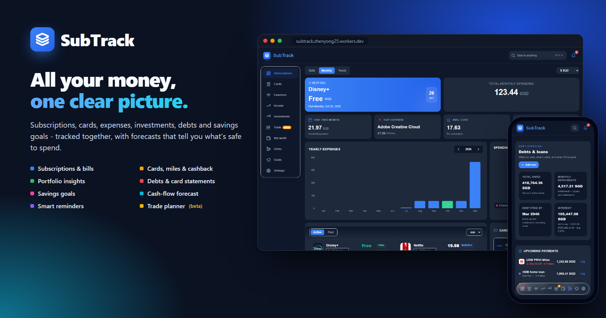

# SubTrack

**Your finances, investments, and money habits in one place.** Track everyday spending, subscriptions, cards, income, portfolios, debts, savings, and insurance — with forecasts, reminders, and a city that grows as you keep good records.

[Open the app](https://subtrack.zhenyong25.workers.dev) · [Features](#features) · [Run locally](#run-locally) · [Deploy](#deploy-to-cloudflare-workers) · [Watch the demo](docs/media/subtrack-promo.webm)
</div>

## Features

| Area | What you can do |
| --- | --- |
| **Subscriptions** | Track recurring bills, free trials, renewal dates, shared payments, and payment history. Search a bundled service catalog, use service logos, and compare spending by year, category, and card. |
| **Cards** | Manage credit, debit, and multi-currency cards; track linked spending, limits, expiry dates, miles, points, and cashback rules. Browse Singapore/Malaysia card catalogues and plan a monthly card mix on the card board. |
| **Expenses** | Record and search spending, review a monthly calendar and category charts, set total/category budgets, and import statement CSVs with duplicate checks. Reconcile card PDF statements against recorded expenses. |
| **Income** | Track recurring and one-time income, active/passive sources, categories, and annual trends. Store and view payslips by pay month when authenticated file storage is configured. |
| **Investments** | Track holdings, brokerage/margin accounts, long and short stock positions, transactions, value history, and portfolio allocation. Review money-weighted returns, dividends, and FIFO tax lots. Crypto, Pokémon cards, and poker have dedicated views. |
| **Trade — beta** | Plan position sizes and risk, explore Time Machine simulations, scan watchlists and in-play stocks, review earnings, study candlestick patterns, and keep stock/options journals. |
| **Net worth** | Combine recorded cash-account balances, investments, and EPF/CPF retirement funds. Explore balance trends, 30/60/90-day forecasts, safe-to-spend estimates, and monthly financial reviews. |
| **Debts** | Track loans and credit-card statements, repayments, interest, due dates, and payoff estimates. Record money owed to you, partial repayments, agreed interest, and write-offs separately. |
| **Goals** | Create savings goals and recurring sinking funds, set targets and deadlines, and record contributions, withdrawals, and funding history. |
| **Insurance** | Organize personal and travel policies, insured people, premiums, coverage limits, deductibles, renewal dates, and claims contacts. Filter policies and inspect metrics per currency. |
| **My City** | Build a 3D city with roads, utilities, homes, businesses, residents, traffic, weather, wildlife, and transit. Complete money-habit missions and visit the accountant and advisor offices for reviews of your records. |
| **Settings and reminders** | Manage profile, display currency, theme, shared-bill contacts, and notification preferences. Inspect cloud-save status and retry eligible failed saves. The header bell collects bill, debt, trial, and goal reminders with snooze/dismiss controls. |

Global search (`Ctrl+K` / `Cmd+K`) finds subscriptions, expenses, and investment transactions by name, notes, amounts, or tags such as `#travel`.

The app supports light/dark themes, labeled mobile navigation, a desktop sidebar, keyboard focus and skip navigation, reduced-motion preferences, and installation as a PWA.

### Portfolio and market tools

- **Stock detail:** Candlestick charts with selectable ranges and intervals, OHLC/volume inspection, zoom/pan, and SMA/EMA overlays for 5, 10, 20, 50, 100, and 200 periods. Pattern markers explain detected shapes. Your buys, sells, transfers, and dividends can be shown on the chart and opened from the transaction list.
- **Portfolio insights:** Allocation by holding, asset class, brokerage account, and currency; concentration indicators; XIRR returns; dividend history/estimates; and FIFO tax lots. Returns rows include holding logos.
- **Crypto:** Track supported public wallets, exchange balances, and manually entered holdings. Supported coins have USD price-history charts, market selection, and quote timestamps. See [crypto charts](docs/crypto-price-charts.md).
- **Pokémon:** Track raw cards and PSA slabs, identify supported printings, compare available market snapshots, and export card-list backups. The hub also includes shops/gyms, events, grading/repair records, and a private scam watchlist. See [Pokémon tracking](docs/pokemon-cards.md).
- **Poker:** Track tournaments, cash games, bankroll movements, filtered results, and cumulative/period charts. See [poker dashboard](docs/poker-dashboard.md).
- **Trading:** Plan, Hot, Scanner, Options, Journal, Rules, Earnings, and Patterns panels. Options currently cover manually entered long calls/puts and expiration payoff calculations; they do not place broker orders. See [options](docs/options.md).

Market data can be delayed or unavailable. Trading tools and simulations are for practice and education, not financial advice. Forecasts depend on the records and assumptions shown in the app; they do not verify bank balances or future returns. The trading workflow draws on [day-trader-skill](https://github.com/Jakeschincariol/day-trader-skill).

## Demos

<table>
  <tr>
    <td width="50%">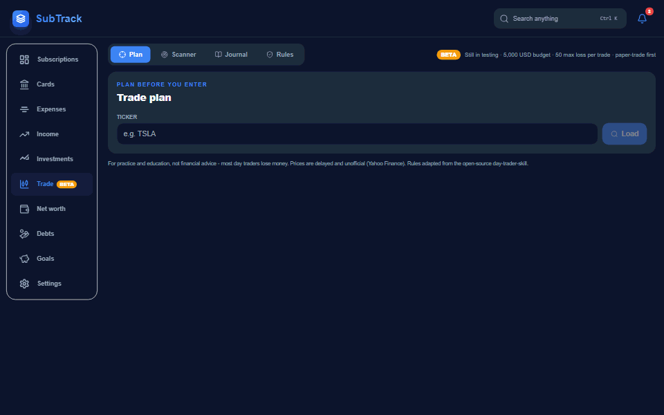<br><b>Trade planner and Time Machine</b></td>
    <td width="50%">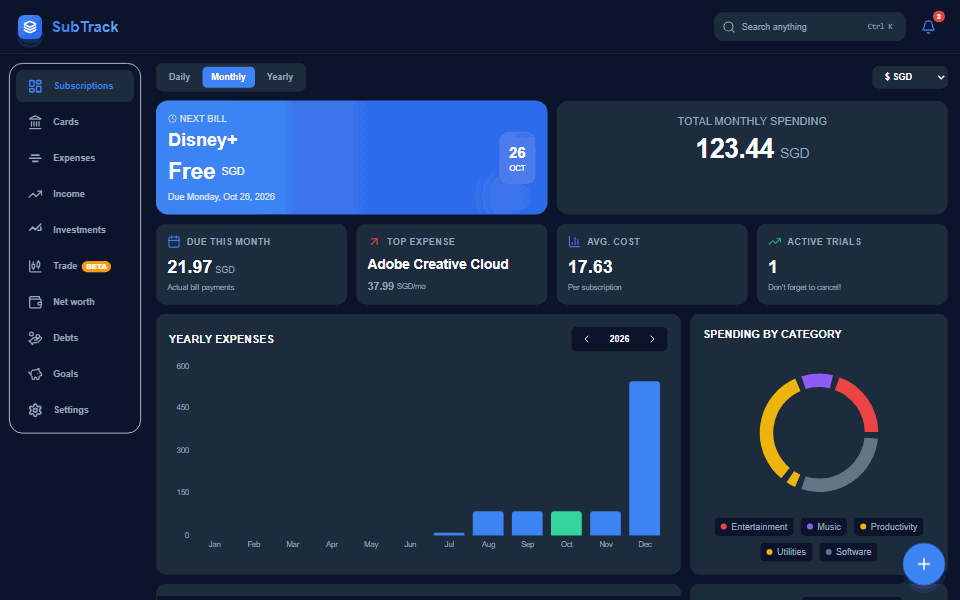<br><b>Global search and tags</b></td>
  </tr>
</table>

<details>
<summary>Open the screenshot gallery</summary>


<table>
  <tr>
    <td width="50%">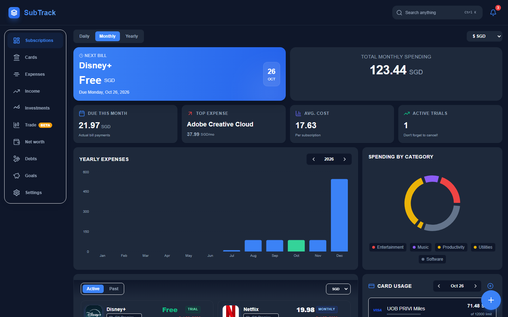<br>Subscriptions</td>
    <td width="50%">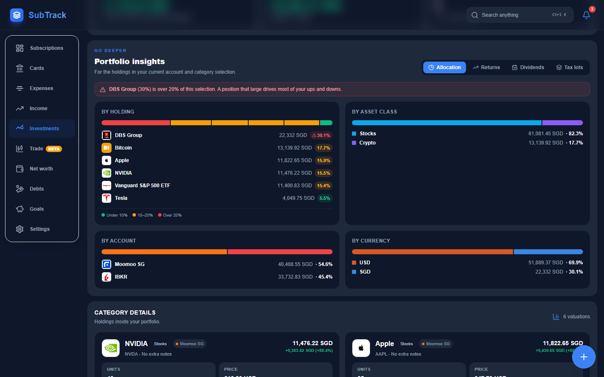<br>Portfolio allocation</td>
  </tr>
  <tr>
    <td>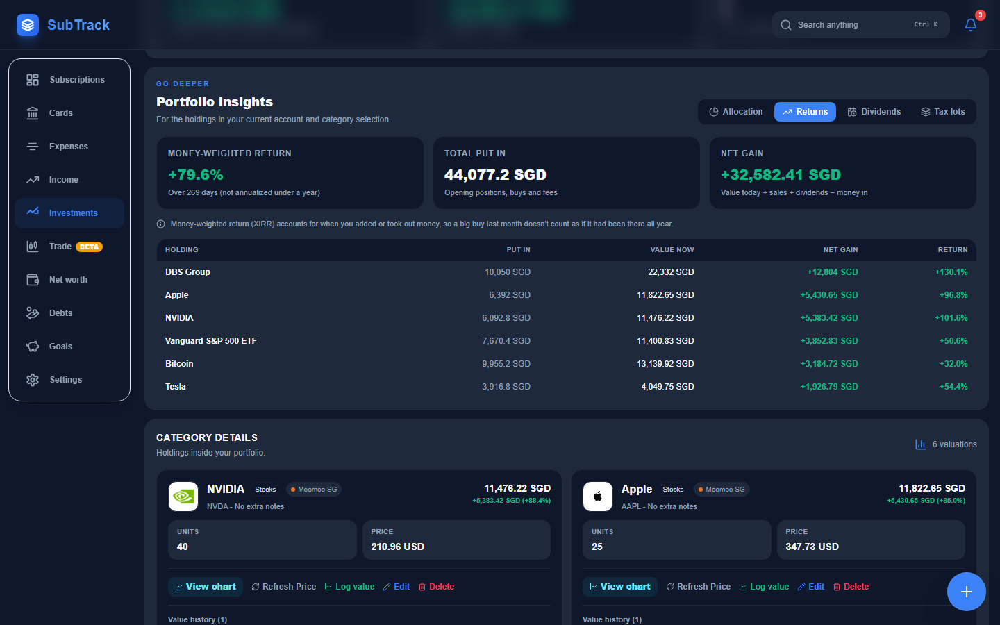<br>Returns and dividends</td>
    <td>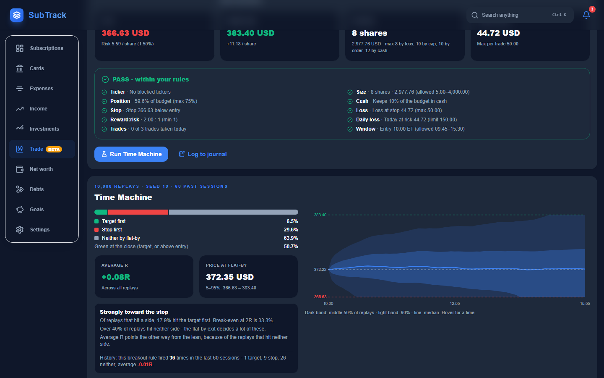<br>Time Machine</td>
  </tr>
  <tr>
    <td>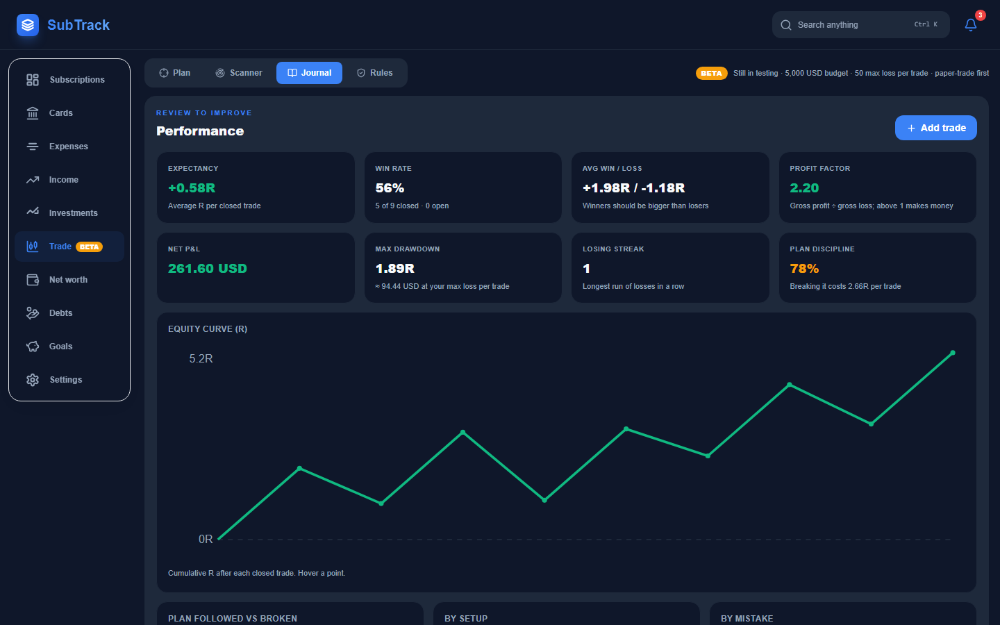<br>Trade journal</td>
    <td>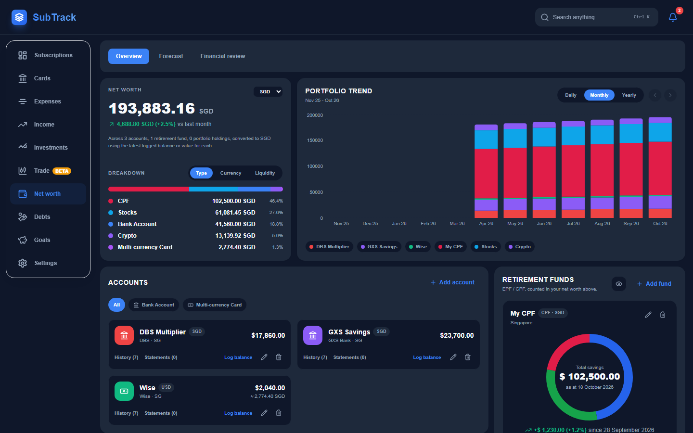<br>Net worth</td>
  </tr>
  <tr>
    <td>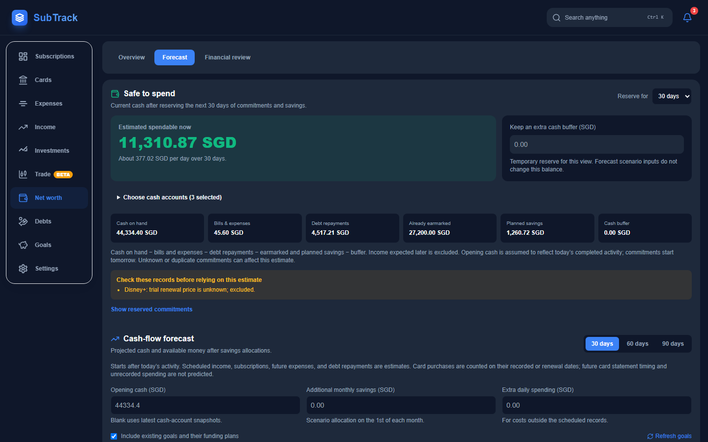<br>Forecast and safe to spend</td>
    <td>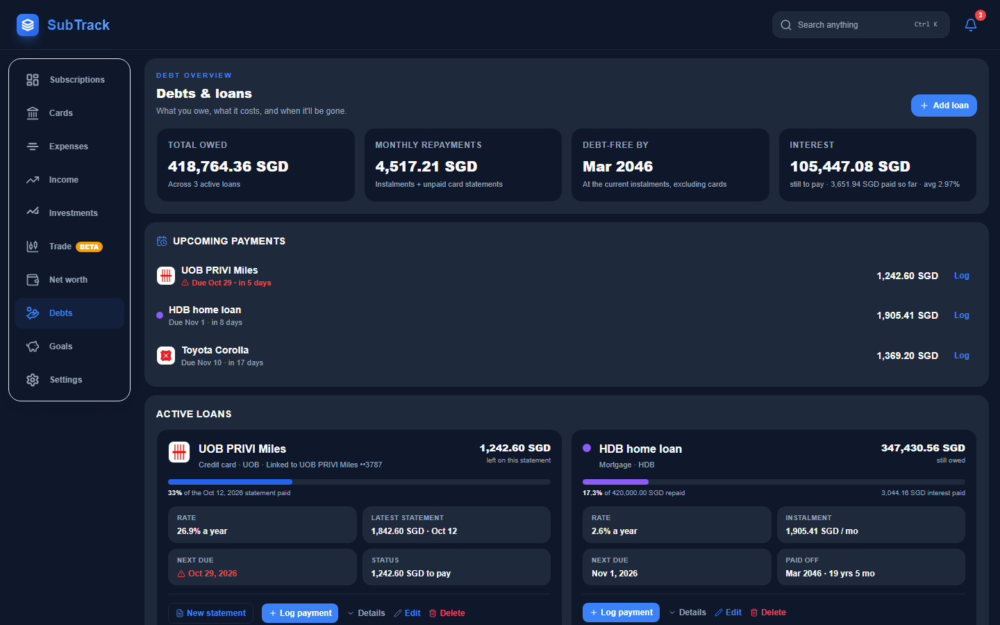<br>Debts</td>
  </tr>
  <tr>
    <td>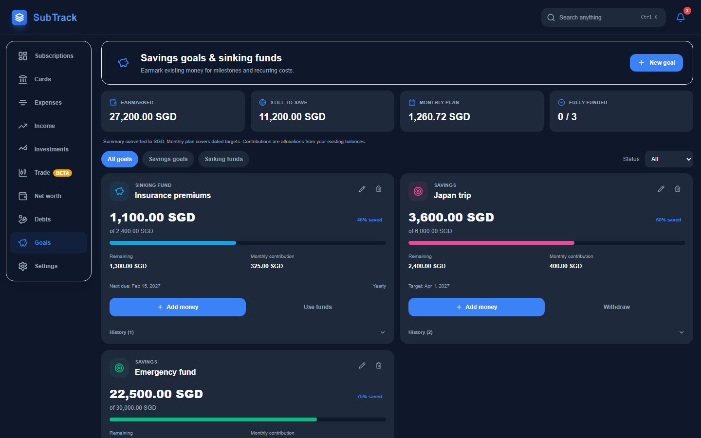<br>Savings goals</td>
    <td>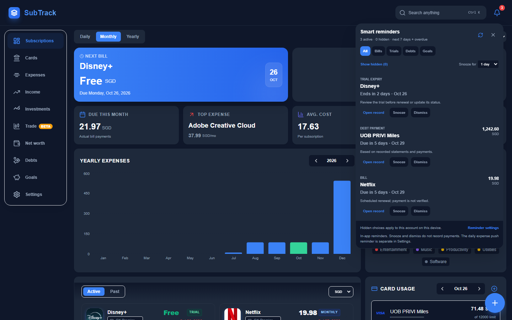<br>Smart reminders</td>
  </tr>
</table>

<p align="center">
  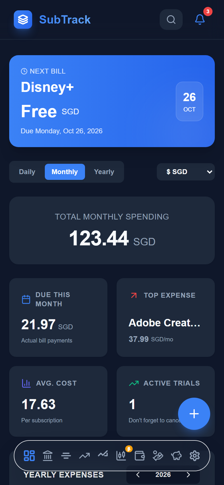
  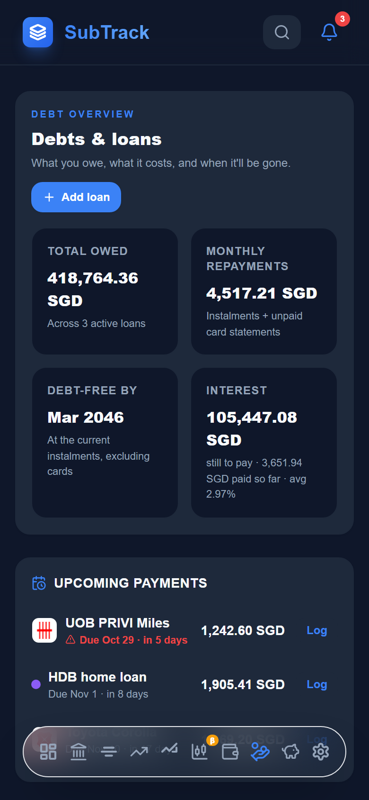
</p>

</details>

Demo media uses fictional records and may show an earlier layout.

## Run locally

Use **Node.js 20.19+ or 22.12+** and npm, matching the project's Vite/React plugin requirements.

```bash
npm ci
npm run dev
```

Open `http://localhost:3000`. Without Supabase configuration, supported local features save data in that browser. No AI key is required to start the app.

For account sync or optional integrations, copy [.env.example](.env.example) to `.env.local`, fill in the relevant values, and restart Vite. Leave the Supabase URL and key empty for local-only use; the example placeholder values are not working credentials.

### Configuration

| Variable | Purpose | Where it is used |
| --- | --- | --- |
| `VITE_SUPABASE_URL` | Supabase project URL | Frontend build |
| `VITE_SUPABASE_ANON_KEY` or `VITE_SUPABASE_PUBLISHABLE_KEY` | Supabase public client key | Frontend build; data access still requires the appropriate authentication and row-level policies |
| `VITE_APP_URL` | Public app URL for email-confirmation redirects | Frontend build |
| `VITE_LOGO_DEV_PUBLISHABLE_KEY` | Optional service/company logos | Frontend build; use a publishable key |
| `VITE_VAPID_PUBLIC_KEY` | Optional web-push subscription setup | Frontend build |
| `HF_TOKEN` | Hugging Face statement-text parsing | Local dev server / application Worker secret |
| `SOLANA_RPC_URL` | Optional Solana wallet RPC endpoint | Local dev server / application Worker secret |
| `PSA_API_TOKEN` | Optional PSA certificate lookup token | Local dev server / application Worker secret |
| `GEMINI_API_KEY` | Optional legacy subscription suggestions | Build-time value; the current implementation includes it in browser JavaScript |

Values prefixed with `VITE_` are public build-time configuration. Keep service-role keys and server tokens in server/Worker secrets.

### Supabase and storage

Configure the URL/public key above, enable the desired authentication method, and set Supabase **Authentication → URL Configuration → Site URL** and allowed redirect URLs to the app's public URL. Include localhost when developing locally.

Feature migrations live in the root as `supabase_*.sql`. They are incremental migrations, not a single fresh-install schema: some assume existing core tables such as `profiles`, `subscriptions`, or `payment_cards`. Read each file's prerequisites before applying it in the same Supabase project as the app.

| Feature | Setup reference |
| --- | --- |
| Subscription catalog and logos | [Catalog setup](docs/subscription-service-catalog.md) |
| Investments, accounts, transactions, shorts, realized P/L | [Investment schema](supabase_investments_schema.sql), [accounts](supabase_investment_accounts_schema.sql), [position side](supabase_investments_position_side.sql), [realized P/L](supabase_investment_realized_pnl.sql) |
| Cash accounts and retirement funds | [Cash accounts](supabase_cash_accounts_schema.sql), [EPF/CPF funds](supabase_retirement_funds_schema.sql) |
| Statements and payslips | [Statement storage](supabase_account_statements_schema.sql), [reconciliation](docs/statement-reconciliation.md), [payslips](docs/payslips.md) |
| Trading and options journals | [Trading schema](supabase_trading_schema.sql), [options setup](docs/options.md) |
| Loans and receivables | [Loan schema](supabase_loans_schema.sql), [money owed to me](docs/receivables.md) |
| Savings and insurance | [Savings setup](docs/savings-goals.md), [insurance setup](docs/insurance.md) |
| Crypto, Pokémon, and poker | [Crypto schema](supabase_crypto_schema.sql), [Pokémon setup](docs/pokemon-cards.md), [Pokémon extras](supabase_pokemon_extras_schema.sql), [poker schema](supabase_poker_schema.sql) |
| My City | [City setup and behavior](docs/finance-world.md), [save schema](supabase_city_game_schema.sql) |
| Tags and notifications | [Search/tags](docs/global-search.md), [notification schema](supabase_notifications_schema.sql), [push subscriptions](supabase_push_subscriptions_schema.sql) |

Authenticated records use owner-scoped access policies. File features require the private `account-statements` bucket and its policies. Local-only support and cloud-failure handling vary by feature; inspect its save status and setup notes. [Cloud sync](docs/cloud-sync.md) explains failed-write retries and their limits.

## Deploy to Cloudflare Workers

The application is deployed as the **`subtrack` Worker**, using [wrangler.toml](wrangler.toml). It serves `dist/` and the server routes in [server/index.ts](server/index.ts), including stock data, crypto, catalogues, and statement parsing. A static-only deployment does not provide those server routes.

Wrangler is already declared in the separate `worker/` package. From the project root, install its locked dependencies and use that CLI for the application deployment:

```bash
npm ci
npm ci --prefix worker
npm run build
node worker/node_modules/wrangler/bin/wrangler.js login
node worker/node_modules/wrangler/bin/wrangler.js deploy --config wrangler.toml
```

Supply frontend configuration before building. For optional server integrations, add application Worker secrets separately, for example:

```bash
node worker/node_modules/wrangler/bin/wrangler.js secret put HF_TOKEN --config wrangler.toml
```

The current live URL is [subtrack.zhenyong25.workers.dev](https://subtrack.zhenyong25.workers.dev).

### GitHub Actions

[.github/workflows/cloudflare-pages.yml](.github/workflows/cloudflare-pages.yml) deploys a **Worker**, despite its historical filename. Pushes to `main` build and deploy; pull requests build only.

- Set repository secrets `CLOUDFLARE_ACCOUNT_ID` and `CLOUDFLARE_API_TOKEN` for deployment.
- The existing workflow reads optional secret `GEMINI_API_KEY` and repository variable `VITE_LOGO_DEV_PUBLISHABLE_KEY`.
- For cloud-backed sign-in and push setup, add the needed `VITE_SUPABASE_*`, `VITE_APP_URL`, and `VITE_VAPID_PUBLIC_KEY` values to the workflow's build environment. Local `.env.local` files are not uploaded to Actions.

### Optional reminder Worker

[worker/](worker/) is a **separate scheduled service**, configured by [worker/wrangler.toml](worker/wrangler.toml). It runs reminder/digest jobs every eight hours and checks stock-price alerts every 15 minutes.

It needs its own `SUPABASE_URL`, `SUPABASE_SERVICE_ROLE_KEY`, `VAPID_PUBLIC_KEY`, `VAPID_PRIVATE_KEY`, and `VAPID_SUBJECT` secrets. Set those in the reminder Worker's directory, then deploy it there with `npm run deploy`. Enable browser notifications in Settings. The in-app reminder bell works separately from this scheduled service.

## Development and checks

The frontend uses React 19, TypeScript, Vite, Tailwind CSS, and Recharts. Three.js powers My City; Leaflet powers maps; pdf.js reads PDFs. Supabase provides optional authentication, database, and private file storage.

```bash
npm run build                # Production SPA and PWA service worker
npm run preview              # Preview the built frontend
npm run test:portfolio       # Returns, allocation, dividends, FIFO lots
npm run test:trading         # Trade planning and pattern calculations
npm run test:ticker          # Ticker statistics and technical indicators
npm run test:planning        # Forecast and safe-to-spend calculations
npm run test:ui:browser      # UI checks; build first and install Chrome/Chromium/Edge
```

`npm run preview` previews the frontend; it does not run the Cloudflare API routes. Use `npm run dev` for the configured local API proxies.

More feature checks are listed in [package.json](package.json), including cards, insurance, Pokémon, poker, loans, receivables, search, reminders, goals, CSV imports, and the city simulation. Browser runners use synthetic fixtures and write screenshots under `artifacts/`. See the [UI review](docs/ui-review.md) for viewport coverage and current TypeScript-check limitations.

## More documentation

- [Forecasts and safe to spend](docs/finance-roadmap.md) · [Financial review](docs/financial-review.md)
- [CSV statement import](docs/csv-statement-import.md) · [PDF statement reconciliation](docs/statement-reconciliation.md)
- [Smart reminders](docs/smart-reminders.md) · [Cloud sync](docs/cloud-sync.md)
- [Stock-chart indicators and patterns](docs/ticker-technical-analysis.md) · [Crypto price charts](docs/crypto-price-charts.md)
- [Savings goals](docs/savings-goals.md) · [Insurance](docs/insurance.md) · [Receivables](docs/receivables.md)
- [My City](docs/finance-world.md) · [Accountant office](docs/city-accountant.md) · [Advisor offices](docs/city-advisor-offices.md)
